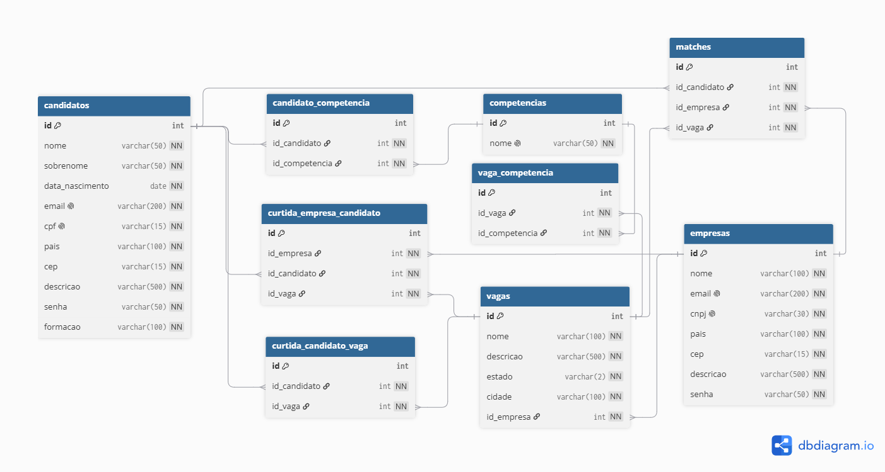

autor: Guilherme Lima Conte

**Como executar:**

O backend são quatro microsserviços Micronaut, em `microsservicos/`, e o site fica em `frontend/`. O passo a passo está na seção [Backend em microsserviços Micronaut](#backend-em-microsserviços-micronaut), no fim deste arquivo.

As seções a seguir contam a evolução do projeto, mas o CLI e a API de servlets que várias delas descrevem foram substituídos pelos microsserviços.

# Informações do projeto:

Optei por explorar o máximo que dava dos benefícios que o groovy proporciona. Para deixar o mais limpo possível não utilizei tipo de visibilidade nas classes, atributos, métodos e construtores e também deixei a maioria dos tipos como def, com exceção das competências que tem como tipo uma lista genérica de strings.
Utilizei do conceito de "Groovy Truth" do curso da udemy no método formatarCompetencias, como listas vazias já possuem valor false me permitiu já iniciar o operador ternário validando a verdade.

É possível adicionar novos candidatos e novas empresas, não foi feito nenhuma validação para confirmar se os tipos estão corretos e no modelo que deve ser seguido no cadastro, mas já é possível.

Devido a diversidade que eu quis deixar nas empresas, não deixei as competências já pré-determinadas para quem vai fazer o cadastro, possibilitando ser qualquer nova competência.

# Front-end

Foi implementando a listagem dos candidatos disponíveis na visão da empresa e as vagas disponíveis na visão do candidato, mostrando todas as informações do candidato/vaga deixando anônimo apenas o nome.
Foi adicionado um cadastro ao lado, da empresa e do candidato.
Por fim da listagem dos candidatos disponíveis há um gráfico em barras adicionado usando a biblioteca chart.js que indica o número de candidatos por competências

## Perfil de recrutador

A feature de recrutador adiciona um terceiro tipo de usuário em `frontend/` e na API REST. O recrutador entra com seu próprio login, vê apenas as vagas atribuídas pela empresa e pode curtir candidatos dentro desse escopo, sem ver dados pessoais sensíveis do candidato fora do que a própria empresa teria acesso.

O recrutador não se autocadastra: a empresa cadastra, atribui e remove vagas dele e pode excluí-lo. Atualizar os dados de um recrutador é feito por `PUT /recrutadores/{id}` no MS Usuários, sem tela no site. As rotas estão no contrato dos microsserviços, mais abaixo, e o que cada perfil pode ver está na spec, em `docs/specs/recrutador/spec.md`.

# Banco de dados

O banco de dados foi desenvolvido utilizando PostgreSQL, graças a ele pude observar um problema crítico em meu projeto que não considerava Empresa e Vaga como classes diferentes, ccom o desenvolvimento do banco de dados, pude perceber esse erro e corrigi-lo. O arquivo localizado em `database/Linketinder.sql` contém todas as criações, inserções e busca realizadas desde sua criação.
Inicialmente o diagrama entidade relacionamento foi feito no site dbdiagram.io, depois realizei o export em Postgre e continuei no pgadmin4.

Para o Desafio ZG foi implementado a sincronização do Groovy com o banco de dados com a criação das classes dentro do diretório `dao`, foi implementado o CRUD das 4 classes exigidas: Candidato, Empresa, Competencia, Vaga. Além de algumas verificações e buscar a fim de evitar uma possível quebra no banco de dados.



# Match e Curtida

Foi implementado duas novas classes Match e Curtida para que a mecânica de um candidato curtir uma vaga e a empresa responsável por aquela vaga curtir o candidato gere um Match para candidato-vaga. Aproveitei o fato de já ter implementado o banco de dados e criei um novo método em VagaDAO para listar todas as vagas daquela empresa e usar dessa informação durante o menu para quando estivermos sendo a "empresa" aparecer todas as vagas que aquela empresa possui.

# Índice de afinidade

Foi adicionado na Visão do Candidato o índice de afinidade que o candidato possui com aquela vaga com base nas competências do candidato/vaga. O cálculo é feito com a quantidade de competências que o candidato tem em comum com a vaga dividido pela quantidade total de competências da vaga.
Foi adicionado também durante a produção do índice um select para simularmos melhor a "experiência" que seria estar na visão naquele candidato. Por ora será assim até a implementação do sistema de login.

# Inserção da lógica de curtida no banco de dados

Foi criado uma tabela de curtida referente ao candidato e uma tabela de curtida referente a empresa/vaga. O match é realizado quando as duas tabelas de curtidas são validadas. Para isso acontecer adicionei uma restrição em vagas que valida se aquela vaga está relacionado com a empresa que iria curtir o candidato, algo que não pode acontecer. Por fim, inserimos algumas curtidas e inserimos a lógica do match e logo depois verificamos isso no `SELECT`. 

# MVP do match

Como já existia a lógica do match devido a inserção da lógica de curtida no bd, nada mais prático do que eu criar uma classe Match que se comunica com o bd também. Devido desde antes eu já ter feito um código para mostrar se o match ocorreu e a listagem de matches, eu aproveitei de uns trecho do código antigo, assim não tendo alteração na main sobre a listagem dos matches.

# Clean code

Agora com a curtidaDAO, a classe Curtida é desnecessário.
Alterei as variáveis que ainda estavam com o tipo def. Entre elas estava a dataNascimento. Agora é do tipo LocalDate e possui um método em Cadastro chamado lerDataNascimento().
estaEmUso era um nome de método que não dizia claramente o que fazia, troquei para estaVinculadoACandidatoOuVaga
Para manter o padrão exibirMatch se tornou exibirDados também.
Coloquei duas variáveis estáticas e constantes para representar o tamanho da senha na hora de cadastrar e o id na main.

Refatorei todas as classes DAO, agora ConexaoBanco tem o método executar que já facilita a abertura e fechamento das conexões, reduzindo muitas linhas repetidas nos DAO. 

Refatorei também as classes Cadastro e Main. Agora Cadastro foi divido em 7 novas classes. A ideia era somente diminuir a classe Cadastro que estava enorme, mas ao fazer essas mudanças notei que alguns métodos estavam muito grandes e fiz a criação de novos, como selecionarCompetencia, selecionaCandidato, etc.. lerDadosVaga, lerDadosEmpresa, etc.. Dessa forma consegui reduzir algumas classes quase pela metade e outras até mais que a metade.

Agora com a classe Cadastro refatorado, foi possível diminuir a main também. Pois agora não possui mais menuCandidato, menuEmpresa, etc.. Também apliquei os testes que haviam deixado de funcionar devido as mudanças do código.

No front-end eu separei todas as funcionalidades que estavam inseridas no main. Agora tem 6 novas classes divididas que fazem a mesma funcionalidade de antes.

Adicionei 6 novas interfaces localizadas no pacote `org.example/repositorio` que são responsáveis em dizer quais operações existem sobre um candidato, vaga, empresa.. Agora uma classe de Cadastro não conhece uma classe que abre conexão com o banco de dados, ela depende da abstração e não de uma classe DAO.
Isso resulta que agora quem instância o DAO é o Main, ele é a única classe que conhece as classes concretas. Em consequência disso agora é possível passar `CandidatoRepositorio` no lugar de `CandidatoDAO` como parâmetro de um Mock. Ou seja, os testes unitários rodam sem banco nenhum.

# Design Pattern

## Factory

ConexaoBanco estava tendo muitas funcionalidades, ele sabia qual banco usar, abria a conexão e executava as consultas, por isso eu separei essas funcionalidades em 5 classes novas aplicando o padrão Factory. O TipoBanco lê da variável de ambiente LINKETINDER_BANCO qual banco usar. 
A interface ProvedorConexao define o contrato de abrir uma conexão, e cada banco tem sua implementação (ProvedorPostgreSQL, ProvedorMySQL). 
E a FactoryConexao recebe o tipo e cria o provedor correto. Assim, trocar de banco não exige mudar o código, só a variável. Agora um banco novo é só mais um provedor.

## Singleton

Antes, o `ConexaoBanco` abria uma conexão nova a cada consulta e a fechava no final. Nas listagens isso se multiplicava, pois cada item faz as próprias consultas internas.
Apliquei o Singleton no `ConexaoBanco` para existir uma única instância dele na aplicação. O construtor é private, então ninguém cria outra com new e a instância fica num campo private static e é obtida por `ConexaoBanco.obterInstancia()`, criada só no primeiro uso. Medindo no Postgre, listar candidatos abria 6 conexões, listar vagas 11, listar matches 13 e agora cada uma usa uma conexão só.
Essa instância abre a conexão uma única vez e a reaproveita em todas as consultas. Antes de usar, `isValid()` confere se ela ainda está ativa e, se o banco tiver reiniciado, uma nova é aberta automaticamente. E ao sair, o Main chama fechar(). Os DAOs continuam recebendo `ConexaoBanco` pelo construtor, no entanto, somente a `Main` chama `obterInstancia()`. Assim o Singleton garante uma instância única sem que cada classe dependa de um método estático.


# MVC

As 7 classes base do projeto foram para o pacote `model`

Os modelos pararam de imprimir `exibirDados()`, agora virou `descrever()` que retorna o texto em vez de imprimir. Pois, agora quem faz a função de imprimir é a view. A leitura do teclado e a impressão saíram das classes de cadastro e foram para as views.

As regras de negócio foram para o service que está entre os controllers e os repositórios.

Quando uma regra recusa a operação, o service lança `RegraDeNegocioException` com uma mensagem, onde o `MenuController` captura e manda a view exibir

O que sobrou das classes de cadastro virou os controllers, que pedem os dados à view, entregam ao service e mandam a view responder. 

O `MenuController` assumiu os menus da `Main` e `CadastroCrud` se tornou `ControllerCrud` implementada pelos quatro controllers de CRUD. 

E agora a `Main` ficou só com a montagem das dependências.


# Integração Frontend com Backend

Como sugerido pela IA na feature anterior eu adotei o uso do CORS filter devido as portas diferentes sendo utilizadas no frontend e backend. Para o login, as interfaces `CandidatoRepositorio` e `EmpresaRepositorio` ganharam o método `buscarPorEmail` e como os DAOs implementam essas interfaces, implementei o método neles também.
O `LoginServlet` recebe o `POST` e usa o método `autenticar` dos services de candidato e empresa que buscam o usuário pelo email e confere a senha.
Adicionei a classe CompetenciaServlet que lista as competências cadastradas e associa as competências escolhidas a um candidato já cadastrado.

No frontend não temos mais o uso do localStorage como banco de dados e agora passou a consumir a API REST do Tomcat. A comunicação foi dividida em `http.ts` que monta a URL e envia o corpo em JSON e `api.ts` que possui uma função para cada endpoint como `cadastrarCandidato`, `fazerLogin` e `listarVagas`.

O login envia `POST` com o tipo do usuário, email e senha. Se os dados estiverem corretos o backend devolve o `tipo`, `id` e `nome` e o frontend guarda essas informações para saber quem está usando a aplicação.

Por segurança, as informações digitadas pelos usuários passam a ser inseridos com `textContent` e não mais com `ìnnerHTML`.

# Melhoria no front-end

Com a integração feita, separei um tempo para melhorar o front-end que necessitava de muitos ajustes.

Agora que está tudo conectado, a página inicial apresenta somente a tela de login. Podendo ser um candidato ou uma empresa. 

Quando o usuário loga como um candidato aparece somente a página de vagas para ele visualizar. Agora as vagas aparecem uma por uma por ordem decrescente de afinidade. Adicionei também dois botões de Curtir e passar para a próxima vaga.

Quando o usuário loga como uma empresa aparece a opção de criar vagas e dela ver as vagas que possui juntamente do gráfico de competências. Ao selecionar a vaga aparece os candidatos em ordem decrescente de afinidade em relação à vaga. E vagas que possuem 0% de afinidade não aparecem pois fogem do escopo da vaga que a empresa procura.

# Backend em microsserviços Micronaut

O backend do Linketinder é formado por quatro microsserviços feitos com o **Micronaut Framework**. Eles substituíram o CLI, a API de servlets no Tomcat e o antigo microsserviço de cadastro, que foram removidos.

Cada microsserviço é uma aplicação à parte, com build Gradle e código próprios, e não importa nada dos outros. Os quatro gravam no mesmo PostgreSQL, e nenhum chama outro: o frontend é o único cliente e fala com cada um pela porta dele.

| Microsserviço | Pasta | Porta | Responsabilidade |
| --- | --- | --- | --- |
| MS Usuários | `microsservicos/ms-usuarios` | `8081` | candidatos, empresas, recrutadores (com a atribuição de vagas) e login |
| MS Competências | `microsservicos/ms-competencias` | `8082` | catálogo de competências e competências do candidato |
| MS Vagas | `microsservicos/ms-vagas` | `8083` | CRUD de vagas, com as competências de cada vaga |
| MS Curtidas | `microsservicos/ms-curtidas` | `8084` | curtidas nos três sentidos e criação do match |

Quando um microsserviço precisa de um dado de outro agregado (por exemplo, o MS Curtidas saber de quem é a vaga), ele consulta direto no banco.

## Recursos utilizados

- Micronaut Platform `5.2.2`, com o plugin Gradle `io.micronaut.application` `5.0.2`
- Groovy `5.0.8` sobre JDK 25 e Gradle `9.6` (wrapper em cada microsserviço)
- `micronaut-serde-jackson` para o JSON e `micronaut-jdbc-hikari` para o `DataSource`
- Driver `org.postgresql:postgresql:42.7.7`, com JDBC puro: sem ORM e sem Micronaut Data
- Spock 2.4 com `micronaut-test-spock`

O código de cada microsserviço segue as camadas `http` (controllers e tratamento de erro) → `service` (regras) → `repositorio` (interfaces) ← `dao` (SQL) → `banco` (conexão). O Micronaut injeta as dependências pelo construtor. Como o JDBC bloqueia a thread, os controllers rodam no executor de bloqueio (`@ExecuteOn(TaskExecutors.BLOCKING)`), fora do event loop do Netty.

## Como executar

1. Deixe o PostgreSQL no ar, com o banco `linketinder` criado pelo script `database/Linketinder.sql`.
2. Abra cada pasta `microsservicos/ms-*` em uma **janela própria do IntelliJ** (`File > Open`). Cada uma é um projeto Gradle independente.
3. Em cada janela, aponte `Settings > Build, Execution, Deployment > Build Tools > Gradle > Gradle JVM` para um **JDK 25**. O plugin do Micronaut 5 exige que o próprio Gradle rode no JDK 25. Pelo terminal isso é automático: o arquivo `gradle/gradle-daemon-jvm.properties` faz o Gradle procurar o JDK 25 instalado, mesmo que o `java` padrão da máquina seja outro.
4. Na configuração de execução (classe `Aplicacao` ou task `run`), defina em *Environment variables* `LINKETINDER_BANCO_SENHA=<sua-senha>`.
5. Rode. O microsserviço sobe na porta da tabela acima.

Pelo terminal, a partir da pasta de cada microsserviço:

```bash
# Git Bash / Linux / macOS
LINKETINDER_BANCO_SENHA=<sua-senha> ./gradlew run
```

```powershell
# PowerShell
$env:LINKETINDER_BANCO_SENHA = "<sua-senha>"; .\gradlew.bat run
```

A configuração vem de variáveis de ambiente, com os mesmos nomes nos quatro:

| Variável | Padrão | Para que serve |
| --- | --- | --- |
| `LINKETINDER_BANCO_SENHA` | não tem | Senha do banco. É obrigatória: sem ela o microsserviço não sobe e avisa qual variável falta |
| `LINKETINDER_BANCO_URL` | `jdbc:postgresql://localhost:5432/linketinder` | Endereço do banco |
| `LINKETINDER_BANCO_USUARIO` | `postgres` | Usuário do banco |
| `MICRONAUT_SERVER_PORT` | a porta do microsserviço | Troca a porta sem recompilar |
| `LINKETINDER_FRONTEND_ORIGEM` | `http://localhost:5173` | Única origem que o navegador pode usar para chamar o microsserviço (CORS) |

A senha do banco não tem valor padrão de propósito: ela não fica escrita no código nem em nenhum arquivo do repositório.

O site fica em `frontend/`:

```bash
cd frontend
npm install
npm run dev        # http://localhost:5173
```

O frontend chama cada microsserviço pela URL base dele, com padrão nas portas `8081` a `8084`. Para trocar, crie um `frontend/.env` (que não vai para o repositório) com `VITE_URL_USUARIOS`, `VITE_URL_COMPETENCIAS`, `VITE_URL_VAGAS` ou `VITE_URL_CURTIDAS`. Com um microsserviço parado, só as telas que dependem dele mostram "Não foi possível conectar ao servidor".

## Contrato

Requisições e respostas são JSON em UTF-8. Todo erro vem no formato `{"erro": "mensagem"}`:

| Status | Quando |
| --- | --- |
| `400` | Campo obrigatório ausente, formato inválido, JSON inválido ou corpo vazio, ou regra de negócio recusada. A mensagem cita o campo, sem repetir o valor enviado |
| `401` | Login com e-mail ou senha errados, com mensagem genérica |
| `403` | Chamada do navegador vinda de uma origem que não é a do frontend |
| `404` | Rota desconhecida ou registro inexistente |
| `405` | Método não aceito na rota, com o cabeçalho `Allow` |
| `409` | Cadastro repetido (e-mail, CPF ou CNPJ de candidato e empresa; nome de competência), com mensagem genérica que não diz qual campo coincidiu |
| `500` | Falha de banco, com a mensagem genérica `Erro ao acessar o banco de dados` |

**MS Usuários (`http://localhost:8081`)**

| Método e rota | O que faz | Sucesso |
| --- | --- | --- |
| `POST /candidatos` | cadastra candidato | `201` + `Location`, cadastro sem a senha |
| `GET /candidatos` | lista candidatos | `200` |
| `GET /candidatos/{id}` | busca candidato | `200` |
| `PUT /candidatos/{id}` | atualiza os dados pessoais (não mexe nas competências) | `200` |
| `DELETE /candidatos/{id}` | exclui candidato, com as competências, curtidas e matches dele | `204` |
| `POST /empresas` | cadastra empresa | `201` + `Location` |
| `GET /empresas` e `GET /empresas/{id}` | lista e busca empresas | `200` |
| `PUT /empresas/{id}` | atualiza empresa | `200` |
| `DELETE /empresas/{id}` | exclui empresa; recusada com `400` se ela tiver vagas ou recrutadores | `204` |
| `POST /recrutadores` | cadastra recrutador de uma empresa | `201` + `Location` |
| `GET /recrutadores?idEmpresa={id}` | lista os recrutadores da empresa | `200` |
| `PUT /recrutadores/{id}` | atualiza recrutador (não troca a empresa) | `200` |
| `DELETE /recrutadores/{id}` | exclui recrutador | `204` |
| `GET /recrutadores/{id}/vagas` | vagas atribuídas ao recrutador | `200` |
| `POST /recrutadores/{id}/vagas` | atribui uma vaga (`{"idVaga": n}`) | `201` com a lista atualizada |
| `DELETE /recrutadores/{id}/vagas/{idVaga}` | desatribui a vaga | `204` |
| `POST /login` | autentica candidato, empresa ou recrutador conforme o `tipo` | `200` com `{tipo, id, nome}`, mais `idEmpresa` para o recrutador |

**MS Competências (`http://localhost:8082`)**

| Método e rota | O que faz | Sucesso |
| --- | --- | --- |
| `GET /competencias` | lista o catálogo (`id`, `nome`) | `200` |
| `POST /competencias` | soma competências a um candidato (`{idCandidato, competencias}`) | `201` com o cadastro do candidato, sem a senha |
| `POST /competencias/catalogo` | cadastra uma competência avulsa (`{nome}`) | `201` + `Location` |
| `PUT /competencias/{id}` | renomeia (`{nome}`) | `200` |
| `DELETE /competencias/{id}` | exclui; recusada com `400` se estiver ligada a candidato ou vaga | `204` |

**MS Vagas (`http://localhost:8083`)**

| Método e rota | O que faz | Sucesso |
| --- | --- | --- |
| `POST /vagas` | cadastra vaga (`idEmpresa`, `nome`, `descricao`, `estado`, `cidade`, `competencias`) | `201` + `Location` |
| `GET /vagas` e `GET /vagas?idEmpresa={id}` | lista todas as vagas, ou as de uma empresa | `200` |
| `GET /vagas/{id}` | busca vaga | `200` |
| `PUT /vagas/{id}` | atualiza a vaga e troca as competências dela (não muda a empresa) | `200` |
| `DELETE /vagas/{id}` | exclui vaga, com competências, curtidas, matches e atribuições dela | `204` |

**MS Curtidas (`http://localhost:8084`)**

| Método e rota | O que faz | Sucesso |
| --- | --- | --- |
| `POST /curtidas` | registra a curtida do candidato na vaga, da empresa no candidato ou do recrutador no candidato, conforme o `tipo` | `201` com `{"match": true\|false}` |

Uma curtida repetida não é erro: responde `201` com `match: false`. A empresa só curte usando uma vaga dela, e o recrutador, uma vaga atribuída a ele; fora disso a resposta é `400`.

### Exemplos

Os dados abaixo são fictícios.

**Cadastrar candidato.** Obrigatórios: `nome`, `sobrenome`, `dataNascimento` (`AAAA-MM-DD`), `email`, `cpf`, `pais`, `cep` e `senha` (de 6 a 50 caracteres). Opcionais: `descricao` e `formacao`.

```bash
curl -i -X POST http://localhost:8081/candidatos \
  -H "Content-Type: application/json" \
  -d '{"nome":"Candidata","sobrenome":"Exemplo","dataNascimento":"2000-01-15","email":"candidata@example.com","cpf":"123.456.789-00","pais":"Brasil","cep":"79000-000","senha":"<uma-senha>","formacao":"Curso de exemplo"}'
```

**Somar competências ao candidato.** Usa o `id` devolvido no cadastro. Uma competência que já existe no catálogo é reaproveitada mesmo com outra caixa (`java` usa a `Java` já cadastrada); a que não existe é criada.

```bash
curl -i -X POST http://localhost:8082/competencias \
  -H "Content-Type: application/json" \
  -d '{"idCandidato":9,"competencias":["java","SQL"]}'
```

**Curtir uma vaga como candidato.**

```bash
curl -i -X POST http://localhost:8084/curtidas \
  -H "Content-Type: application/json" \
  -d '{"tipo":"candidato","idCandidato":9,"idVaga":1}'
```

```json
{"match":false}
```

Atenção no Windows: um acento digitado direto na linha de comando do `curl` pode sair em outra codificação. Nesse caso, salve o JSON em um arquivo UTF-8 e envie com `--data-binary @arquivo.json`.

### Observações

- O contrato das rotas que o site já usava foi mantido, com duas mudanças: cadastro repetido de candidato ou empresa passou de `500` para `409`, e a validação de candidato e empresa ficou mais rígida (a do antigo microsserviço de cadastro).
- Nenhuma resposta traz a senha, e as do recrutador nunca trazem CPF nem data de nascimento.
- As rotas não têm autenticação, como antes: quem souber um `id` consegue ler, alterar ou excluir. `GET /candidatos`, `GET /empresas` e `GET /vagas` devolvem mais dados do que o site mostra. Essas pendências estão no `AGENTS.md`.
- O log de cada microsserviço registra só o método, o modelo da rota e o status, nunca o corpo nem dados pessoais.

## Testes

```bash
cd microsservicos/ms-usuarios
./gradlew test
```

Cada microsserviço tem a própria suíte em Spock, que não precisa de banco: as regras são testadas com repositórios simulados, e as rotas sobem o servidor Micronaut em uma porta livre, com os DAOs trocados por mocks. São 331 testes no total: 176 no MS Usuários, 69 no MS Competências, 41 no MS Vagas e 45 no MS Curtidas. A gravação no PostgreSQL foi conferida manualmente.

No frontend, a checagem de tipos é `npx tsc --noEmit`.
